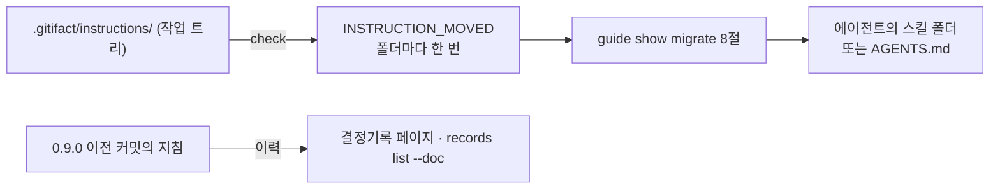

## 개요

0.9.0부터 Gitifact는 이 프로젝트에서 어떻게 일하는지를 관리하지 않는다. 일하는 방식은 AGENTS.md나 에이전트의 스킬에 두고, 에이전트가 원래 읽는 방식으로 읽는다. Gitifact에 남은 일은 0.8의 지침이 작업 트리에 남았을 때 막고 안내하는 것과, 옛 커밋의 지침을 이력에서 읽는 것 두 가지다. 위키를 뺐을 때(0.8.0)와 같은 방식이다.

## 작업 트리의 지침

`check`는 `.gitifact/instructions/` 아래 파일을 문서로 읽지 않고, 폴더(`.gitifact/instructions/<이름>`)마다 `INSTRUCTION_MOVED` 문제를 한 번 낸다. 문서로 읽지 않으므로 그 지침을 가리키는 설계의 `sources`는 `MISSING_REFERENCE`가 된다. 캐시는 지침의 `index.md`를 문서로 넣지 않고 같은 문제로 남겨, 목록 명령과 브라우저가 읽지 못한 파일로 보인다.

커밋 전 변경을 계산할 때 지침의 Markdown은 원문대로 읽는다. 그대로 둔 지침은 HEAD와 같아 변경으로 나오지 않고, 지운 지침은 삭제로 나와 옮기는 커밋에 함께 실린다. 지침 폴더의 다른 파일은 경로만 넘긴다.

`instructions` 명령, `guide show instructions`, 브라우저의 프로젝트 지침 화면과 `/api/v1/instructions` 경로는 없다. 체크아웃(v2)의 색인과 검색(v4)에도 지침이 없다.

## 옛 지침의 이력

0.9.0 이전 커밋의 지침(`I-`)은 커밋 기록을 읽는 쪽에서 계속 문서로 읽는다. 결정기록 페이지, 문서 이력, 커밋 페이지가 종류(지침)와 본문 비교를 보이고, 현재 문서로 가는 링크는 두지 않는다. `specs show`는 `--ref`로 커밋을 지정할 때만 지침을 보인다. 이력의 문서 종류 필터는 이력에 지침이 있을 때만 지침을 고를 수 있게 한다.

## 옮길 곳

옮기는 절차는 `guide show migrate`의 8절이다. 옮길 곳은 사용자가 정하고, 스킬로 옮기면 `index.md`가 `SKILL.md`가 되며 `id`·`title` 대신 `name`·`description`을 쓴다. Gitifact는 스킬 폴더를 만들거나 동기화하지 않는다. 이 저장소는 `.agents/skills/`에 두고, Claude Code는 세션 시작 훅이 `.claude/skills/`로 복사한 사본을 읽는다.
