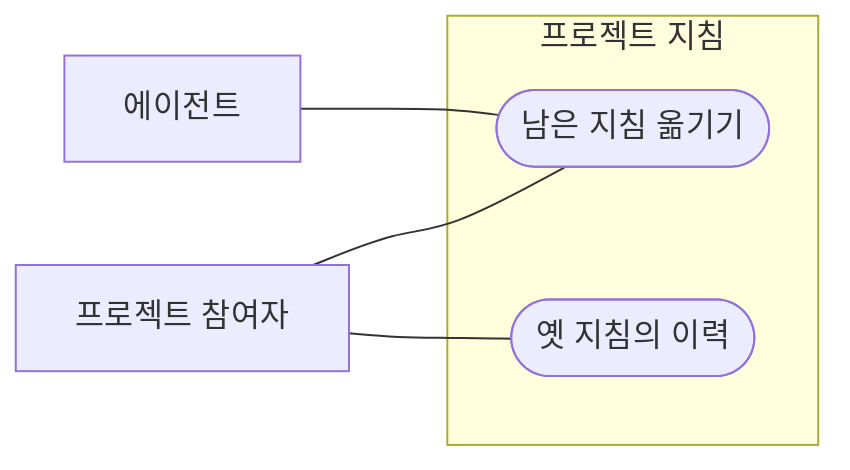

0.8에서는 이 프로젝트에서 어떻게 일하는지(아키텍처 규칙, 문체, 검증 절차)를 `.gitifact/instructions/<이름>/`의 지침 문서로 두고 Gitifact가 ID·검사·이력·브라우저를 맡았다. 0.9.0부터 Gitifact는 요구사항·설계·결정기록에 집중하고 지침을 관리하지 않는다. 일하는 방식은 에이전트가 원래 읽는 AGENTS.md나 에이전트의 스킬에 둔다. 이 기능은 남은 지침을 그곳으로 옮기게 안내하고, 옛 지침의 이력을 계속 보여 준다.

## 유즈케이스 모델

