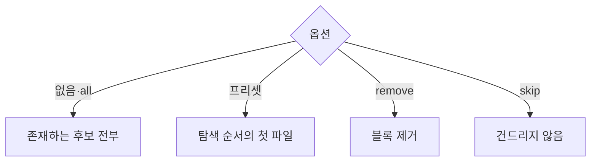
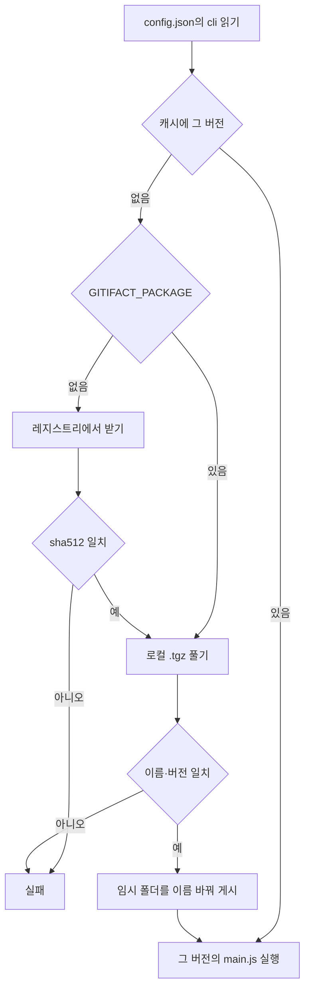

## 대상 파일

후보 파일은 AGENTS.md, CLAUDE.md, .claude/CLAUDE.md, .cursorrules, .hermes.md, HERMES.md다(`apps/cli/src/commands/agent-block.ts`). CLI는 실행 중인 에이전트를 감지하지 않고, 어느 파일에 쓸지는 기존 파일과 옵션으로 정한다. 구조는 Astryx CLI(MIT)의 agent-docs를 따랐다.

| 옵션 | 처리 |
| :--- | :--- |
| 없음, `--agent all` | 존재하는 후보 전부에 쓴다. `@AGENTS.md`처럼 다른 후보만 가져오는 파일은 건너뛴다. 하나도 없으면 AGENTS.md를 보일러플레이트 헤더와 함께 만든다 |
| `--agent claude\|cursor\|codex\|hermes` | 아래 탐색 순서에서 처음 존재하는 파일에 쓰고, 없으면 마지막 후보를 만든다 |
| `--remove-agents` | 블록을 지우고 헤더만 남은 파일은 삭제한다. `--agent`와 함께 쓰면 그 프리셋의 후보만 본다 |
| `--skip-agents` | 지침 파일을 건드리지 않는다 |

| 프리셋 | 탐색 순서 |
| :--- | :--- |
| `claude` | CLAUDE.md → .claude/CLAUDE.md |
| `cursor` | .cursorrules → AGENTS.md |
| `codex` | AGENTS.md |
| `hermes` | .hermes.md → HERMES.md → AGENTS.md |

보일러플레이트 헤더는 `# <파일 이름>`과 `Project-specific guidance for AI coding agents.` 두 줄이다. 다른 후보만 가져오는 파일에 이전 실행이 펼친 블록이 있으면 설치 때 걷어낸다.

## CLAUDE.md

CLAUDE.md는 새로 만들지 않는다. Claude Code는 CLAUDE.md가 없으면 AGENTS.md를 읽고, 이미 있는 CLAUDE.md·.claude/CLAUDE.md는 후보 파일이라 블록을 함께 받는다. 0.9.0 이전 init은 CLAUDE.md가 없으면 `@AGENTS.md` 한 줄짜리 wrapper를 만들었다. 그 파일은 다른 후보만 가져오는 파일이라 이후 init·update가 블록을 넣지 않는다.

`--remove-agents`는 AGENTS.md를 삭제할 때 CLAUDE.md의 내용이 앞뒤 공백을 빼고 정확히 `@AGENTS.md`면 함께 삭제한다. AGENTS.md에 사용자 내용이 남거나 사용자가 CLAUDE.md를 고쳤으면 남긴다.

## 블록 형식

블록 본문은 `apps/cli/src/shared/i18n/<lang>/block.md`다. `renderAgentBlock`이 `{topics}` 자리를 채우고 `<!-- GITIFACT:START -->`·`<!-- GITIFACT:END -->` 마커로 감싼다. 본문은 `## Gitifact Guide` 제목으로 시작하며 버전·언어·저장 규약을 적지 않는다. 버전은 설정의 `cli`, 저장 규약은 `schemaVersion`에 있다. 그래서 블록 문구가 바뀌지 않는 배포에서는 블록도 바뀌지 않는다.

블록 언어는 설정의 `language`다. 한 번의 실행에서 모든 블록을 한 언어로 쓰며 `--lang`으로 지정한 언어, 설정의 `language`, 0.8.2 이하가 쓴 블록 첫 줄(`gitifact vX · ko · … schemaVersion N`)의 언어, 현재 표시 언어 순으로 고른다. 첫 줄은 `legacyBlockLanguage`가 줄 전체 일치로 찾고, 언어 토큰이 없으면 한국어로 본다. 고른 언어는 init·update가 설정의 `language`에 쓰므로, 표시 언어가 다른 팀원이 실행해도 블록이 번역본으로 바뀌지 않는다. CLI 메시지의 표시 언어는 설정에 저장하지 않는다.

제목 다음에 `.gitifact`와 `gitifact`가 무엇인지 한 문단으로 알리고, `###` 절 다섯이 이어진다. 세션을 시작할 때(실행기로 실행하기, 실행기가 없을 때 업데이트 명령 제안, Git 상태와 staging 점검)는 순서 목록, 무엇을 요구사항으로 남기는가는 요청 분류 표, 작업할 때는 상황마다 먼저 할 일(읽을 명세·결정 흐름과 `guide show` 주제, 결정기록, 커밋, 브라우저, 피드백)의 표, 지킬 것은 버전 안내에 대한 질문·커밋 권한·CLI 대신 하지 않기·SELF-CHECK 같은 규칙, 명령은 이름과 목록 페이지다. 상세는 주제별 지침에 두고 블록은 언제 무엇을 읽을지만 알린다. 마커를 포함해 50줄 이내다.

> [!IMPORTANT]
> Markdown은 연속한 일반 줄을 한 문단으로 합친다. 블록의 모든 줄은 제목·목록·표·독립 문단으로 쓰고, 끝은 빈 줄과 `---`로 마커 바깥 내용과 구분한다. 빈 줄 없이 `---`를 두면 앞 줄이 제목이 된다.

## 블록 쓰기와 마커

블록은 기존 파일의 줄바꿈(CRLF 포함)을 따르고, 결과가 기존 내용과 같으면 쓰지 않는다. 마커 상태별 처리는 `injectBlock`·`findBlock`이 정한다.

| 대상 파일 | 처리 |
| :--- | :--- |
| 없음 | 보일러플레이트 헤더, 빈 줄, 블록 순으로 만든다 |
| START·END 한 쌍 | 마커 사이만 교체한다 |
| 마커 없음 | 끝 공백을 정리하고 빈 줄 뒤에 블록을 덧붙인다 |
| START만, END만, START 중복 | `AGENT_DOCS_MALFORMED`로 거부한다 |

`update`는 이미 블록이 있는 파일만 다시 쓰고 새 파일을 만들지 않는다. init이라면 만들 파일(예: wrapper)은 결과의 `agentDocs.missing`으로 알린다. 0.2.0의 스킬 설치본은 1.0.0 이전이라 호환을 다루지 않는다.

## 지침 문서

상세 규칙은 `apps/cli/src/shared/i18n/<lang>/docs/`의 Markdown이다. workflow·spec·design·records·writing·commit·migrate 지침이 있다. 빌드가 `dist/i18n/<lang>/docs`로 복사하고 `gitifact guide show <topic>`이 그대로 출력한다. `guide list`는 각 파일의 `title`·`description` 프론트매터로 목록을 만든다.

지침 텍스트의 편집 원본은 이 한 곳이다. 스킬 파일, 매니페스트, 복사본 검사는 두지 않는다.

## 실행 방법

에이전트와 사람은 Gitifact를 프로젝트의 실행기로 `node .gitifact/bin/cli.mjs <명령>`처럼 실행한다. 블록 안의 `gitifact`는 이 명령을 뜻한다. 프로젝트가 기준으로 삼는 버전은 설정의 `cli`이고 블록에는 버전이 없다. 블록은 실행기 파일이 없으면 `npx --yes gitifact@<cli 버전> update`를, 버전 안내가 보이면 안내의 업데이트 명령을 그대로 보여 주며 사용자에게 허용을 묻게 하고(업데이트는 지금과 나중에(`gitifact update --later`) 중 하나), 허용받으면 에이전트가 직접 실행하게 한다. 사용자에게 설치를 떠넘기지 않는다. Claude Code 자동 모드의 검사기는 사용자 메시지가 실행할 동작을 구체적으로 가리킬 때만 약한 차단을 풀기 때문에, 질문에 정확한 명령을 넣어 사용자의 짧은 허용이 그 명령을 가리키게 한다. 도구가 그래도 막으면 에이전트는 그 도구의 승인 창(샌드박스 밖 실행 요청 등)이나 권한 설정으로 승인을 받는다. Windows PowerShell에서 스크립트 실행이 막혀 있으면 `npx.cmd`로 실행한다. 프로젝트가 별도 실행 방법을 지정하면 그것이 우선하고, 블록 안의 `gitifact`는 그 실행 방법의 약칭이다. CLI는 실행 환경을 감지하거나 프로젝트 의존성 추가를 대신 하지 않는다.

한국어·영어 소개, 시작하기, 블록, workflow 지침이 같은 절차를 안내한다. 도입 프롬프트는 에이전트에게 `npx --yes gitifact init`을 실행하게 하고, 직접 쓸 때는 `npx --yes gitifact init` 뒤 `node .gitifact/bin/cli.mjs browser`다. 짧은 `gitifact`로 치고 싶은 사람을 위한 전역 설치(`npm install -g gitifact`)는 시작하기에 선택 사항으로만 적는다.

업데이트는 `npx --yes gitifact@<새 버전> update` 한 번이다. 블록, 설정의 `cli`, 실행기를 새 버전으로 바꾸고, 커밋된 변경을 받은 팀원의 실행기는 다음 실행에서 새 버전을 받는다(D-yrow77r5pf). init·update의 텍스트 출력도 이 명령을 보인다. 계약은 project-init v8(`install.npx`·`install.npmGlobal`)·update v6(`install.npmGlobal`)이다. 실행이 막히면 에이전트는 승인을 요청하고 원인을 알린다. 명세 기록을 수동으로 대체하거나 성공으로 보고하지 않는다. 업데이트 동의는 커밋·푸시 권한을 포함하지 않는다.

## 프로젝트 실행기

실행기는 `.gitifact/bin/cli.mjs` 한 파일이다. 원본은 `apps/cli/src/shared/launcher/cli.mjs`이고, 빌드가 `dist/launcher/cli.mjs`로 복사하며, `init`·`update`가 `refreshLauncher`(`adapters/filesystem/launcher-file.ts`)로 프로젝트에 쓴다. 없거나 내용이 다를 때만 쓰고(CRLF는 LF로 맞춰 비교), 그 자리의 링크나 폴더는 거부한다. 설정의 `cli`가 실행 중인 CLI보다 새 버전인 프로젝트에서는 블록과 마찬가지로 실행기도 다시 쓰지 않는다. 실행기는 Gitifact의 파일이라 사용자 수정을 보존하지 않는다. 프로젝트와 함께 커밋하며 `changes commit`이 저장소 파일로 받고, `update --commit`이 블록·설정과 함께 커밋한다.

셸 스크립트나 `.cmd`를 두지 않는다. Windows의 Git은 실행 비트를 유지하지 않을 수 있고, PowerShell은 확장자 없는 파일을 제대로 열지 못하기 때문이다. Node는 이미 필요하므로 `node`로 실행한다.

| 단계 | 동작 |
| :--- | :--- |
| 버전 | 실행기 옆 `../config.json`의 `cli`. 읽지 못하거나 버전 형식이 아니면 실패한다 |
| 캐시 | `<cache>/cli/<version>/package/dist/main.js`. `<cache>`는 업데이트 확인과 같은 사용자 캐시 폴더다(D-yrow77r5pf) |
| 받기 | 레지스트리(`npm_config_registry`, 기본 `https://registry.npmjs.org`)의 `gitifact/<version>` 매니페스트에서 `dist.tarball`과 `dist.integrity`를 읽는다. sha512가 아니거나 받은 내용과 다르면 실패한다 |
| 로컬 패키지 | `GITIFACT_PACKAGE`가 있으면 그 .tgz를 레지스트리 대신 쓴다. 공개되지 않은 빌드를 시험할 때 쓴다 |
| 풀기 | `<cache>/cli/.tmp-*`에 풀고, `package/package.json`의 이름이 `gitifact`이고 버전이 같을 때만 `<version>`으로 이름을 바꾼다. 패키지 밖을 가리키는 경로는 거부한다. 동시에 받은 다른 실행이 먼저 게시했으면 그것을 쓴다 |
| 실행 | `process.execPath`로 main.js를 실행하고 인자와 종료 코드를 그대로 전달한다 |

받기·풀기에 실패하면 `gitifact launcher:`로 시작하는 한 줄을 stderr에 쓰고 종료 코드 1로 끝나며, 임시 폴더는 지운다. 오프라인이면 다음 실행에서 다시 받는다. 캐시는 버전별 폴더라 프로젝트마다 다른 버전을 써도 서로 영향이 없다. 캐시의 이전 버전은 지우지 않는다.

| 검사 | 위치 | 확인하는 것 |
| :--- | :--- | :--- |
| 실행기 | `apps/cli/test/launcher.test.mjs` | 로컬 패키지로 실행한 뒤 캐시에서 실행, 인자·종료 코드 전달, 이름·버전이 다른 패키지 거부와 캐시 비움, 레지스트리에서 한 번 받기와 무결성 불일치 거부 |
| 패키지 | `scripts/test-package.mjs` | 설치된 CLI의 init이 쓴 실행기가 원본과 같고, `GITIFACT_PACKAGE`로 준 같은 버전의 패키지를 오프라인으로 실행하는지 |

> [!NOTE]
> 권한이 막혔을 때 실제 에이전트가 승인을 요청하는지는 자연어 지침만으로 보장하지 않는다.
