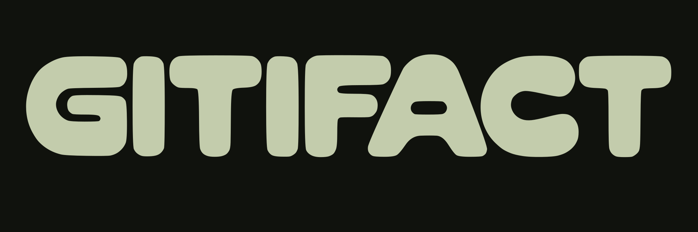
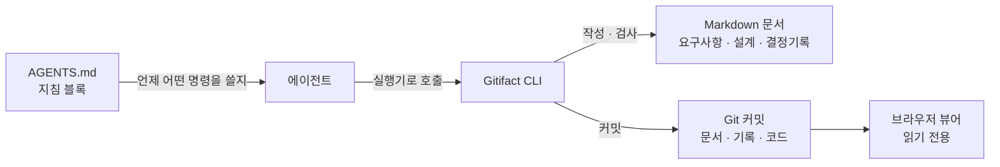

<p align="center">
  
</p>

[English](https://github.com/dev-goraebap/gitifact/blob/main/README.md)

Gitifact는 AI 에이전트와 대화하며 나온 요구사항, 설계, 변경 이유를 소스 코드와 같은 저장소에서, 같은 커밋으로 관리하는 오픈소스 CLI 도구입니다.

평소처럼 에이전트와 대화하며 제품을 만드는 흐름 속에서 "이 제품이 지금 무슨 동작을 하는지", "이 코드는 왜 이렇게 바뀌었는지"라는 맥락이 코드와 함께 Git에 조용히 남도록 돕습니다.

## 그냥 git log를 찾아보면 안 되나요?

에이전트에게 git log와 diff를 읽게 할 수는 있습니다. 하지만 에이전트와 함께 제품을 계속 만들어갈 때, 과거 변경 이력만으로는 답하기 어려운 질문들이 생깁니다.

- **지금 이 제품은 정확히 무슨 동작을 하나요?**
  코드는 지금 무엇을 하는지는 보여 주지만, 어떤 동작이 지켜야 할 규칙이고 어떤 것이 우연히 그렇게 된 것인지는 알려 주지 않습니다. 그 의도를 git log에서 찾으려 해도 커밋 메시지에 이유가 남아 있는 경우는 드뭅니다.
  Gitifact는 제품이 보장해야 할 동작을 요구사항으로 따로 두어, 에이전트가 코드를 고치기 전에 무엇을 지켜야 하는지 읽게 합니다. 기술 구조가 필요한 기능은 설계 문서도 함께 두어 구현 맥락을 확인하게 합니다.

- **이 결정은 왜 내렸고, 어떤 대안을 버렸나요?**
  커밋 메시지에는 대개 '무엇을 했는지'만 적힙니다. "A 대신 B를 시도했다가 이런 문제가 있어서 버렸다"는 이야기는 커밋 메시지에 거의 남지 않습니다. 이전 대화를 모르는 새 세션의 에이전트는 이미 검토 끝에 버린 안을 다시 제안하기도 합니다.
  Gitifact의 결정기록은 그 결정이 필요했던 맥락과 선택한 내용뿐 아니라, 검토했다가 버린 대안과 그 까닭까지 함께 남깁니다. 에이전트가 코드를 고치기 전에 관련 결정 흐름을 확인해, 이미 검토 끝에 버린 안을 다시 제안하는 일을 줄이게 합니다.

- **파일을 옮기거나 쪼개면 이전 이력은 어떻게 되나요?**
  Git은 파일 경로와 줄 단위로 변경을 추적합니다. 리팩터링으로 코드를 여러 파일로 쪼개거나 폴더를 옮기면 파일 단위 diff가 끊겨 과거 변경 맥락을 따라가기 어려워집니다.
  Gitifact는 요구사항과 설계마다 고유 ID를 부여하고, 커밋할 때 Git 트레일러로 문서와 결정 흐름을 연결합니다. 파일 이름이 바뀌거나 다른 폴더로 이동하더라도 문서 ID를 통해 그 문서가 거쳐 온 결정 흐름을 계속 조회할 수 있게 합니다.

- **중간 시행착오마다 문서를 다 고쳐야 하나요?**
  화면을 보며 빠르게 시도하고 되돌리는 대화 과정마다 문서를 개정하면 개발 흐름이 끊깁니다. 대화 중에는 에이전트가 요구사항 초안을 다듬으며 코드를 수정하게 둡니다.
  작업을 마친 뒤 아직 커밋하지 않았으면 에이전트가 먼저 커밋을 제안합니다. 커밋하지 않은 채 다음 작업으로 넘어가려 할 때도, 두 작업의 결정과 변경이 섞이기 전에 커밋하자고 제안합니다. 실제 커밋은 사용자가 허락하거나 프로젝트 정책이 있을 때만 수행하며(푸시는 별도로 요청받습니다), 그 시점에 정리된 문서, 결정기록, 코드, 테스트를 한 커밋으로 묶어 Git에 남깁니다.

- **규칙만 정해두면 결국 기록을 빼먹지 않나요?**
  "문서를 꼭 갱신하자"는 다짐은 바쁜 개발 중에 쉽게 잊힙니다. Gitifact는 CLI로 문서 상태를 검사합니다. 기존 문서를 고쳤는데 설명하는 결정기록이 없거나, 초안 상태가 남아 있거나 끊긴 참조가 있으면 커밋 전에 알려주어 기록 누락을 줄이도록 돕습니다.

## 시작하기

진행 중인 프로젝트나 새 프로젝트에서, 사용하는 에이전트에게 아래 프롬프트를 건네면 됩니다.

```text
이 프로젝트에서 npx --yes gitifact init을 실행하세요.
명령이 막히면 저에게 넘기지 말고 명령을 그대로 보여 주며 허용을 물어보세요.
init이 AGENTS.md 등에 쓴 GITIFACT 블록을 읽고 이번 세션부터 따르세요.
```

그다음부터는 평소처럼 만들고 싶은 기능이나 바꾸고 싶은 동작을 이야기하면 됩니다.

- 에이전트는 코드를 작성하기 전에 관련 요구사항과 설계를 확인하고, 필요한 경우 초안을 먼저 작성합니다.
- 불명확한 제품 동작만 질문하고, 나머지는 판단해 진행합니다.
- 기존 요구사항을 수정하거나 여러 대안 중 하나를 고르면 결정기록을 작성합니다.
- 작업을 마쳤을 때 커밋하지 않았거나 다음 작업으로 넘어가려 하면 에이전트가 먼저 커밋을 제안합니다. 사용자가 승인하면(또는 프로젝트 정책에 따라) 문서, 결정기록, 코드, 테스트를 한 커밋으로 묶어 커밋합니다. (푸시는 별도로 요청받습니다.)
- 기록된 문서와 결정 이력을 확인하고 싶다면 "gitifact 브라우저를 열어주세요"라고 요청하면 됩니다.

새 버전이 나오면 gitifact 명령이 알려 주고, 에이전트가 업데이트할지 묻습니다. 직접 명령을 실행하려면 [CLI 안내](https://github.com/dev-goraebap/gitifact/blob/main/apps/cli/README.md)를 참고하세요.

## 구조

기록의 원본은 Git 저장소 안의 Markdown 문서와 커밋 이력입니다.



- **AGENTS.md (지침 블록):** `init`이 에이전트 지침 파일에 블록을 작성합니다. 언제 어떤 명령을 써야 하는지만 담겨 있으며, 상세한 형식은 에이전트가 필요할 때 내장 가이드(`gitifact guide show`)로 찾아 읽습니다.
- **실행기와 CLI:** 저장소에 포함된 실행기 파일이 프로젝트 기준 버전의 CLI를 사용자 캐시에 받아 실행합니다. 전역 설치 없이 프로젝트마다 지정된 버전을 사용합니다.
- **문서:**
  - **요구사항과 설계:** 제품이 지켜야 할 동작과 수용 조건, 그리고 기술 구조를 Markdown 문서로 유지합니다.
  - **결정기록:** 문서가 왜 그렇게 바뀌었는지의 맥락과 결정, 검토한 대안을 담는 기록입니다.
- **커밋과 트레일러:** CLI가 바뀐 문서, 결정기록, 코드를 한 커밋에 담고, Git 트레일러로 커밋과 문서를 연결합니다.
- **내장 브라우저 뷰어:** `gitifact browser`로 열리는 로컬 웹 앱입니다. 로컬 Git 저장소의 파일과 이력을 읽어 기능별 명세, 결정기록의 흐름, 참여자 현황을 읽기 전용으로 보여줍니다.


## 원칙과 범위

- **Markdown과 Git 이력이 원본입니다:** 모든 기록은 일반 Markdown 파일과 표준 Git 커밋으로 관리합니다. Gitifact를 더 이상 사용하지 않더라도 작성된 요구사항과 결정기록은 저장소의 Git 이력에 그대로 남습니다.
- **점진적으로 도입할 수 있습니다:** 이전 이력을 거슬러 올라가 문서화할 필요 없이, 새로 추가하거나 수정하는 기능부터 기록을 시작하면 됩니다.
- **단일 Git 저장소에 집중합니다:** 하나의 Git 저장소(단일 프로젝트 또는 모노레포) 안에서 제품 개발과 기록 관리가 완결되는 구조를 전제로 합니다.

## 프로젝트 상태

Markdown 요구사항·설계와 결정기록을 Git 커밋에 연결하고, 브라우저 뷰어에서 결정기록·요구사항·참여자를 볼 수 있습니다. 에이전트에게 "gitifact 브라우저를 열어주세요"라고 요청하세요.

최신 공개 버전은 [npm](https://www.npmjs.com/package/gitifact)에서, 버전별 변경 내역은 [패치노트](https://github.com/dev-goraebap/gitifact/blob/main/apps/cli/src/shared/i18n/ko/changelog.md)에서 확인하세요.

제품의 목적·원칙·범위는 이 문서에서, 기능별 요구사항과 설계는 [요구사항](https://github.com/dev-goraebap/gitifact/tree/main/.gitifact/spec)에서 확인할 수 있습니다.

## 라이선스

[MIT](https://github.com/dev-goraebap/gitifact/blob/main/LICENSE).
