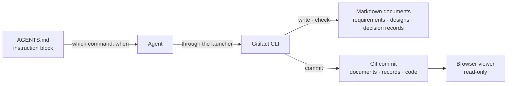

<p align="center">
  
</p>

[한국어](https://github.com/dev-goraebap/gitifact/blob/main/README.ko.md)

Gitifact is an open-source CLI that keeps the requirements, designs, and reasons for changes that come out of conversations with AI agents in the same repository as your source code, in the same commits.

As you keep building with your agent the way you already do, it helps the context of "what this product does right now" and "why this code changed" stay in Git alongside the code.

## Can't I just search git log?

You can have your agent read git log and diffs. But as you keep building a product with an agent, some questions are hard to answer from the change history alone.

- **What exactly does this product do right now?**
  Code shows what it does now, but not which behavior is a rule to keep and which just happened to turn out that way. Looking for that intent in git log rarely works, because commit messages seldom record the reason.
  Gitifact keeps the behavior the product must guarantee as requirements, so the agent reads what it has to keep before changing the code. Features that need technical structure also get design documents, so the agent can check the implementation context.

- **Why was this decided, and what was ruled out?**
  Commit messages usually record only what was done. "We tried B instead of A and dropped it because of this problem" rarely makes it into a commit message. A new agent session that doesn't know the earlier conversation may propose an option that was already considered and dropped.
  A Gitifact decision record keeps the context that called for the decision and what was chosen, along with the alternatives that were considered and why they were dropped. The agent checks the related decisions before changing the code, which cuts down on proposing options that were already ruled out.

- **What happens to the history when files move or split?**
  Git tracks changes by file path and line. When a refactor splits code into several files or moves a folder, the per-file diff breaks and the earlier context becomes hard to follow.
  Gitifact gives each requirement and design a unique ID and links documents and decisions with Git trailers at commit time. Even when a file is renamed or moved to another folder, the decisions a document went through stay queryable by its ID.

- **Do I have to update the documents for every trial and error?**
  Revising documents at every step of a conversation where you try things quickly and roll them back breaks the flow of development. During the conversation, the agent refines a draft of the requirements while it changes the code.
  When the work is done and not yet committed, the agent offers to commit. It also offers to commit before moving on to the next task, so the decisions and changes of two tasks don't get mixed. It commits only when you allow it or the project has a policy for it (pushing is a separate request), and at that point it puts the settled documents, decision records, code, and tests into one commit.

- **If it's just a rule, won't records get skipped eventually?**
  A resolution to "always update the docs" is easy to forget in the middle of busy development. Gitifact checks the documents with its CLI. If an existing document changed without a decision record explaining it, a draft is left, or a reference is broken, it says so before the commit, which helps keep records from going missing.

## Getting started

In a project you're starting or one already underway, give this prompt to the agent you use:

```text
Run npx --yes gitifact init in this project.
If the command is blocked, don't hand it to me: show me the exact command and ask for my approval.
Read the GITIFACT block that init adds to AGENTS.md or the relevant agent instructions file, and follow it from this session onward.
```

From then on, describe the feature you want to build or the behavior you want to change, as usual.

- Before writing code, the agent checks the related requirements and designs, and writes a draft first when needed.
- It asks only about unclear product behavior and decides the rest itself.
- When it changes an existing requirement or picks one of several options, it writes a decision record.
- When the work is done without a commit, or before moving on to the next task, the agent offers to commit. Once you approve (or under the project's policy), it puts the documents, decision records, code, and tests into one commit. (Pushing is a separate request.)
- To see the recorded documents and decision history, ask "Open the Gitifact browser."

When a newer version is out, gitifact commands say so and your agent asks whether to update. To run commands yourself, see the [CLI guide](https://github.com/dev-goraebap/gitifact/blob/main/apps/cli/README.md).

## How it fits together

The source of the records is the Markdown documents and commit history in your Git repository.



- **AGENTS.md (instruction block):** `init` writes a block into your agent instruction file. It says only which command to use when; the agent reads the detailed formats from the built-in guides (`gitifact guide show`) when it needs them.
- **Launcher and CLI:** A launcher file in the repository fetches the CLI version the project is set to into your user cache and runs it. Each project uses its own version without a global installation.
- **Documents:**
  - **Requirements and designs:** The behavior and acceptance criteria the product must keep, and its technical structure, kept as Markdown documents.
  - **Decision records:** Records of why a document changed: the context, the decision, and the alternatives considered.
- **Commits and trailers:** The CLI puts the changed documents, decision records, and code into one commit and links the commit to the documents with Git trailers.
- **Built-in browser viewer:** A local web app opened with `gitifact browser`. It reads the files and history of your local Git repository and shows the specifications by feature, the flow of decision records, and contributors, read-only.


## Principles and scope

- **Markdown and Git history are the source:** Every record is a plain Markdown file and a standard Git commit. If you stop using Gitifact, the requirements and decision records you wrote stay in your repository's Git history as they are.
- **Adopt it gradually:** There's no need to go back and document past history; start recording from the features you add or change next.
- **One Git repository:** Gitifact assumes product development and its records live within one Git repository (a single project or a monorepo).

## Project status

Gitifact connects Markdown requirements, designs, and decision records to Git commits. The browser viewer shows decision records, requirements, and contributors. Ask your agent to “Open the Gitifact browser.”

Find the latest published version on [npm](https://www.npmjs.com/package/gitifact) and version-by-version changes in the [release notes](https://github.com/dev-goraebap/gitifact/blob/main/apps/cli/src/shared/i18n/en/changelog.md).

This document describes the product's purpose, principles, and scope. Feature requirements and designs live in the [specifications](https://github.com/dev-goraebap/gitifact/tree/main/.gitifact/spec).

## License

[MIT](https://github.com/dev-goraebap/gitifact/blob/main/LICENSE).
